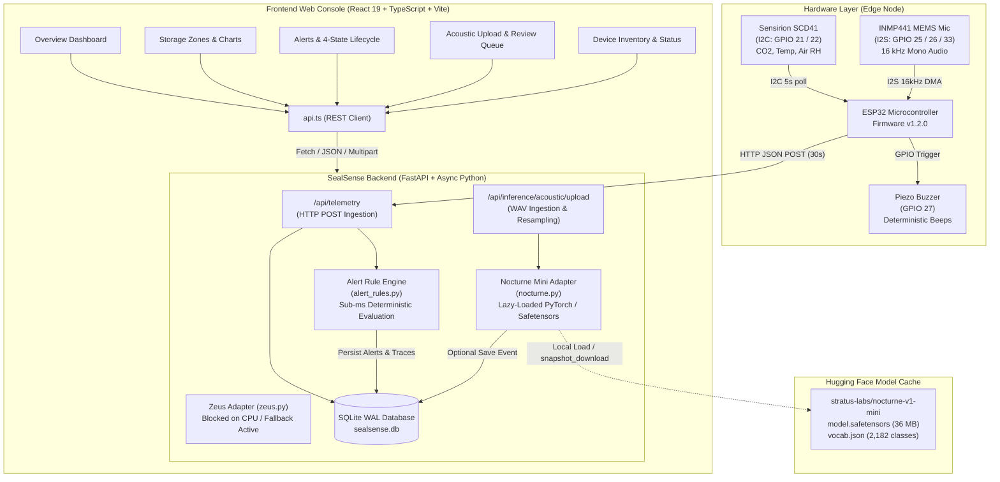

# SealSense — Intelligent Grain Storage Telemetry & Bioacoustic Monitoring Platform

> An IoT sensing, deterministic environmental alerting, and experimental bioacoustic monitoring system for hermetic and bulk grain storage silos.

[](package.json)
[](backend/requirements.txt)
[-003B57?logo=sqlite&logoColor=white)](backend/app/database.py)
[](firmware/sealsense_node/sealsense_node.ino)
[-FF6F00?logo=huggingface&logoColor=white)](backend/app/adapters/nocturne.py)

---

## Table of Contents

1. [Project Overview](#1-project-overview)
2. [Features & Capabilities](#2-features--capabilities)
   - [Environmental Monitoring](#environmental-monitoring)
   - [Alert Management & Alarm Lifecycle](#alert-management--alarm-lifecycle)
   - [Acoustic Monitoring & Recorded Audio Upload](#acoustic-monitoring--recorded-audio-upload)
   - [Frontend Operator Console](#frontend-operator-console)
3. [System Architecture](#3-system-architecture)
   - [Architecture Diagram](#architecture-diagram)
   - [Repository Directory Tree](#repository-directory-tree)
4. [Prerequisites & System Requirements](#4-prerequisites--system-requirements)
5. [Installation & Local Development](#5-installation--local-development)
   - [Step 1: Clone Repository](#step-1-clone-repository)
   - [Step 2: Frontend Setup (Vite + React)](#step-2-frontend-setup-vite--react)
   - [Step 3: Backend Setup (FastAPI)](#step-3-backend-setup-fastapi)
   - [Step 4: Environment Configuration](#step-4-environment-configuration)
   - [Step 5: Running Both Services Locally](#step-5-running-both-services-locally)
6. [Machine Learning Setup & Adapter System](#6-machine-learning-setup--adapter-system)
   - [Optional ML Dependencies](#optional-ml-dependencies)
   - [Nocturne Mini Acoustic Adapter](#nocturne-mini-acoustic-adapter)
   - [Zeus Environmental Model Adapter (Blocked by Design)](#zeus-environmental-model-adapter-blocked-by-design)
   - [Running Model Diagnostic & Verification](#running-model-diagnostic--verification)
   - [Critical Domain Safeguards & Data Attribution](#critical-domain-safeguards--data-attribution)
7. [Recorded Acoustic Audio Ingestion Pipeline](#7-recorded-acoustic-audio-ingestion-pipeline)
   - [Upload API Endpoint Contract](#upload-api-endpoint-contract)
   - [Audio Validation, Downmixing, and Resampling](#audio-validation-downmixing-and-resampling)
   - [Example cURL Upload Requests](#example-curl-upload-requests)
   - [Browser Dropzone & Three-Way Demo Workflow](#browser-dropzone--three-way-demo-workflow)
8. [Public Reference Audio, Synthetic Simulation & Dataset Evaluation](#8-public-reference-audio-synthetic-simulation--dataset-evaluation)
   - [Public Reference Dataset Integration (USDA Bug Bytes)](#public-reference-dataset-integration-usda-bug-bytes)
   - [Synthetic Bioacoustic Impulse & Feeding Simulation](#synthetic-bioacoustic-impulse--feeding-simulation)
   - [Defective Hardware Fallback & Three-Way Demonstration Workflow](#defective-hardware-fallback--three-way-demonstration-workflow)
   - [Persistent Audio Storage Outside SQLite](#persistent-audio-storage-outside-sqlite)
   - [Sample Metadata, Provenance & Ground-Truth States](#sample-metadata-provenance--ground-truth-states)
   - [Independent Physical Verification Methods](#independent-physical-verification-methods)
   - [Scientific Guardrails & Taxonomic Boundaries](#scientific-guardrails--taxonomic-boundaries)
   - [Offline Evaluation Utility (CLI)](#offline-evaluation-utility-cli)
   - [Dataset Manifest Export (JSON & CSV)](#dataset-manifest-export-json--csv)
9. [API Reference](#9-api-reference)
10. [Database & Persistence Model](#10-database--persistence-model)
11. [Hardware & ESP32 Firmware Guide](#11-hardware--esp32-firmware-guide)
    - [Wiring & Pinout Reference](#wiring--pinout-reference)
    - [Firmware Configuration & Upload](#firmware-configuration--upload)
    - [Crucial Domain Distinction: Air RH vs. Grain Moisture](#crucial-domain-distinction-air-rh-vs-grain-moisture)
12. [Testing & Verification Suites](#12-testing--verification-suites)
13. [Development Workflow & Extension Guide](#13-development-workflow--extension-guide)
14. [Security & Production Considerations](#14-security--production-considerations)
15. [Implementation Status & Roadmap](#15-implementation-status--roadmap)

---

## 1. Project Overview

### What is SealSense?
**SealSense** is an IoT environmental telemetry and bioacoustic investigation platform designed for hermetic grain storage silos, agricultural warehouses, and bulk grain bags. It combines:
1. **Low-power edge sensing nodes (ESP32)** measuring ambient carbon dioxide ($\text{CO}_2$), temperature, and air relative humidity (RH).
2. **A deterministic, sub-millisecond rule-based alert engine** that detects grain spoilage risks, aerobic respiration spikes, and microclimate heating.
3. **An experimental acoustic investigation pipeline** using deep bioacoustic student neural networks (`stratus-labs/nocturne-v1-mini`) to analyze sound recordings for pest activity indicators.
4. **An operator-grade web console** inspired by modern industrial observability platforms (ThingsBoard alarm lifecycles, Home Assistant automation execution traces, Frigate event review queues, and Edge Impulse sample inspectors).

### Problem Statement
Post-harvest grain loss accounts for 10% to 25% of stored grain globally due to insect pest infestation (*Sitophilus oryzae*, *Rhyzopertha dominica*, *Tribolium castaneum*) and fungal decay. In sealed (hermetic) or bulk storage:
- **Aerobic respiration** from active insects and mold consumes oxygen and causes rapid spikes in $\text{CO}_2$ concentration.
- **Biological activity** generates localized hotspots (temperature rises) and releases moisture into the intergranular air space.
- **Acoustic emission** from insect locomotion and kernel feeding produces faint, high-frequency sound signals in the 1–8 kHz band.

By combining continuous atmospheric sensing with on-demand acoustic investigation, storage operators can detect biological activity weeks before grain discoloration, odor, or structural spoilage occurs.

### Intended Users & Operational Workflows
- **Grain Silo Managers & Cooperative Operators:** Monitor silo headspace microclimates across storage zones in real time.
- **Agricultural Quality Inspectors:** Review acoustic anomalies, listen to 10-second audio windows, and record audited human validation sign-offs before applying fumigation or grain cooling.
- **Warehouse Maintenance Teams:** Track device health, battery life, sensor connectivity timeouts, and physical I2C/I2S hardware status.

### Current Implementation vs. Product Vision
| Area | Implemented in Current Codebase | Experimental / In Progress | Planned Future Work |
|---|---|---|---|
| **Environmental Telemetry** | HTTP JSON ingest (`POST /api/telemetry`), SQLite WAL storage, InfluxDB-style downsampling rollups. | Continuous firmware Wi-Fi posting with 5-minute sampling loop. | MQTT broker integration, mesh networking (ESP-NOW/LoRa). |
| **Alert Engine** | Deterministic thresholds, 4-state ThingsBoard alarm lifecycle, 5-step Home Assistant execution traces. | Trend evaluation over 3 consecutive telemetry readings. | Multi-sensor sensor fusion, grain temperature gradient models. |
| **Acoustic Inference** | End-to-end WAV upload (`POST /api/inference/acoustic/upload`), strict RIFF validation, mono downmix, 16 kHz resample, Nocturne Mini CPU inference (~85 ms). | Synthesized chirp smoke-testing, Frigate-style 2-tier review queue (alert vs. detection). | Dedicated storage pest model fine-tuning; real-time on-node I2S streaming over WebSockets. |
| **Operator Console** | 5 comprehensive pages (Overview, Zones, Alerts, Acoustic, Devices) with dark-mode industrial theme. | Browser-based synthetic audio generator, human validation modals. | Multi-tenant authentication, role-based access control (RBAC). |

---

## 2. Features & Capabilities

### Environmental Monitoring
- **Multi-Sensor Metrics:** Continuous monitoring of Carbon Dioxide ($\text{CO}_2$ in ppm), Temperature (°C), and Air Relative Humidity (RH %).
- **Zone Hierarchy:** Silo capacity grouped by storage zones (`zone-a`, `zone-b`, `zone-c`) with per-zone device assignments.
- **Telemetry Downsampling & Gap Detection:** InfluxDB-inspired continuous downsampling (`/api/readings/aggregate`) computing minimum, maximum, and average values over configurable time buckets (15-min to 1-hour) while explicitly identifying sensor transmission gaps.
- **Device Inactivity Monitoring:** Automatic calculation of device active status based on a configurable timeout window (`inactivity_timeout_sec`, default 300 seconds).

### Alert Management & Alarm Lifecycle
- **Authoritative Rule Engine ([`backend/app/alert_rules.py`](backend/app/alert_rules.py)):** Sub-millisecond deterministic evaluation running independently of any ML components:
  - $\text{CO}_2$ Warning: $\ge 700\text{ ppm}$ | Critical: $\ge 1,200\text{ ppm}$
  - $\text{CO}_2$ Trend: $\ge +200\text{ ppm}$ rise across 3 consecutive readings
  - Temperature Warning: $\ge 25.0^\circ\text{C}$ | Critical: $\ge 30.0^\circ\text{C}$
  - Air RH Warning: $\ge 70.0\%$ | Critical: $\ge 80.0\%$
- **ThingsBoard 4-State Alarm Lifecycle:** Full state machine support across:
  1. `active_unack` — Active condition, unacknowledged by operator.
  2. `active_ack` — Active condition, acknowledged by operator.
  3. `cleared_unack` — Metric returned to normal range, awaiting operator sign-off.
  4. `cleared_ack` — Metric normal and acknowledged; archived.
- **Home Assistant-Inspired Automation Traces:** Every generated alert produces an auditable 5-step execution trace (`/api/alerts/{id}/trace`) recording the exact trigger, conditions evaluated, thresholds tested, and resulting action.

### Acoustic Monitoring & Recorded Audio Upload
- **Real Model Inference:** Lazy-loaded integration with the official Hugging Face model [`stratus-labs/nocturne-v1-mini`](https://huggingface.co/stratus-labs/nocturne-v1-mini) (9.4M parameter EfficientNet-B1 student model).
- **Recorded Audio Ingestion:** Dedicated `POST /api/inference/acoustic/upload` endpoint supporting direct WAV file uploads up to 20 MB.
- **Audio Preprocessing Pipeline:** Validates RIFF/WAVE header magic bytes, downmixes stereo/multichannel to mono, resamples arbitrary sample rates (8–192 kHz) to 16 kHz, and standardizes audio to a 10.0-second window (padding short clips with silence, truncating long clips).
- **Physical Envelope & Spectral Peaks:** Extracts a 16-bar RMS waveform envelope and 3-peak FFT spectrogram for UI preview.
- **Frigate-Style Event Triage:** Categorizes acoustic events into `alert` (anomaly score $>0.05$) vs. `detection`, supporting individual inspection or batch review.
- **Human-in-the-Loop Sign-Off:** Edge Impulse-inspired validation workflow allowing agricultural inspectors to mark events as `validated` (true anomaly) or `rejected` (false positive) with audit timestamps.

### Frontend Operator Console
- **Single Page App:** Built with React 19, TypeScript, Vite, and TailwindCSS.
- **Five Dedicated Operator Pages:**
  1. [`Overview.tsx`](src/pages/Overview.tsx): High-level silo vitals, zone health status pills, critical alert feeds, and quick scenario switching.
  2. [`StorageZones.tsx`](src/pages/StorageZones.tsx): Zone-by-zone environmental metric cards, historical time-series charts (Recharts), and InfluxDB time-bucket aggregation.
  3. [`AlertsEvents.tsx`](src/pages/AlertsEvents.tsx): 4-state alarm lifecycle management, acknowledgement modals, and execution trace inspection drawer.
  4. [`AcousticMonitoring.tsx`](src/pages/AcousticMonitoring.tsx): WAV drag-and-drop file upload, synthetic audio generator, 16-bar waveform visualizer, top-5 model prediction breakdown, and Frigate review queue.
  5. [`DevicesSensors.tsx`](src/pages/DevicesSensors.tsx): ESP32 hardware inventory, I2C/I2S sensor statuses (SCD41, INMP441, Buzzer), firmware versions, and last-seen activity trackers.

---

## 3. System Architecture

### Architecture Diagram



### Repository Directory Tree

```text
sealsense/
├── backend/
│   ├── app/
│   │   ├── adapters/
│   │   │   ├── __init__.py           # Adapter exports
│   │   │   ├── base.py               # Shared schemas (DependencyReport, AcousticInferenceResult)
│   │   │   ├── nocturne.py           # Nocturne Mini EfficientNet-B1 loader & WAV ingestion
│   │   │   └── zeus.py               # Zeus foundation model adapter & hardware validator
│   │   ├── __init__.py
│   │   ├── alert_rules.py            # Deterministic environmental thresholds & alert generation
│   │   ├── database.py               # Async SQLite connection & automatic schema migrations
│   │   ├── demo_data.py              # Realistic test scenarios (healthy, rising risk, acoustic, etc.)
│   │   ├── main.py                   # FastAPI application, CORS, routers & endpoints
│   │   └── models.py                 # Pydantic models (Readings, Events, Alerts, Traces, Buckets)
│   ├── tests/
│   │   ├── test_model_adapters.py    # 17 unit tests for adapters, audio ingest, and upload routes
│   │   └── test_rea_features.py      # 8 feature verification tests (ThingsBoard, Frigate, InfluxDB, etc.)
│   ├── model_adapter_test.py         # Standalone CLI compatibility diagnostic suite
│   ├── requirements-ml.txt           # Optional ML dependencies (PyTorch CPU, torchaudio, timm, etc.)
│   └── requirements.txt              # Core backend dependencies (FastAPI, uvicorn, aiosqlite, pydantic)
├── firmware/
│   └── sealsense_node/
│       └── sealsense_node.ino        # ESP32 Arduino firmware for SCD41, INMP441, and telemetry HTTP POST
├── public/
│   ├── favicon.svg                   # Silo telemetry brand icon
│   └── icons.svg
├── src/
│   ├── assets/                       # UI assets & logos
│   ├── components/
│   │   ├── Layout.tsx                # Navigation sidebar, header status, and responsive shell
│   │   ├── MetricCard.tsx            # Industrial sensor card with min/max thresholds
│   │   ├── ScenarioSelector.tsx      # Quick scenario switcher (healthy, rising risk, combined warning)
│   │   └── SourceBadge.tsx           # REAL vs. SIMULATED vs. MODEL_EXPERIMENT badge
│   ├── hooks/
│   │   └── useApi.ts                 # React hook managing API polling, state, and demo fallback
│   ├── lib/
│   │   ├── api.ts                    # Strongly-typed fetch client for all backend endpoints
│   │   └── demo.ts                   # In-browser fallback state generator
│   ├── pages/
│   │   ├── AcousticMonitoring.tsx    # WAV upload dropzone, waveform visualizer, and Frigate review
│   │   ├── AlertsEvents.tsx          # 4-state alarm lifecycle and automation trace inspector
│   │   ├── DevicesSensors.tsx        # ESP32 hardware inventory and connectivity tables
│   │   ├── Overview.tsx              # System summary dashboard, zone vitals, active alarms
│   │   └── StorageZones.tsx          # Microclimate time-series charts and telemetry aggregation
│   ├── types/
│   │   └── index.ts                  # Core TypeScript types and API interfaces
│   ├── App.css
│   ├── App.tsx                       # React Router configuration
│   ├── index.css                     # Curated industrial dark theme and design tokens
│   └── main.tsx                      # Vite React entrypoint
├── .gitignore                        # Strict rules ignoring venv, node_modules, weights, db, logs
├── eslint.config.js                  # ESLint configuration
├── index.html                        # HTML shell
├── package.json                      # Frontend dependencies & scripts
├── package-lock.json
├── tsconfig.app.json
├── tsconfig.json
├── tsconfig.node.json
└── vite.config.ts
```

---

## 4. Prerequisites & System Requirements

| Component | Verified Minimum | Recommended | Notes |
|---|---|---|---|
| **Operating System** | Linux (Ubuntu 22.04+, Zorin OS 17+) | Linux x86_64 or macOS | Developed and verified on Linux `7.0.0-38-generic x86_64`. |
| **Python** | Python `3.10` | Python `3.12.x` | Required for backend. Python `3.12.3` verified. |
| **Node.js** | Node.js `18.x` | Node.js `20.x` or `22.x` | Required for frontend build. Node `v22.x` verified. |
| **npm** | npm `9.x` | npm `10.x` | Package manager for frontend dependencies. |
| **Disk Space** | ~250 MB (Core app only) | ~1.5 GB (With PyTorch CPU & weights) | Nocturne Mini snapshot requires ~38 MB in Hugging Face cache. |
| **RAM** | 2 GB | 4 GB+ | Pure CPU inference requires ~400 MB resident memory. |
| **Hardware (Firmware)** | None (Demo simulator included) | ESP32-WROOM-32, SCD41, INMP441 | Optional; required only for physical node compilation. |

---

## 5. Installation & Local Development

### Step 1: Clone Repository
```bash
git clone https://github.com/ayushduttatreya/sealsense.git
cd sealsense
```

### Step 2: Frontend Setup (Vite + React)
From the repository root:

```bash
# 1. Install Node.js dependencies
npm install

# 2. Start Vite development server
npm run dev
```
The frontend starts by default on **`http://localhost:5173`**.

Other frontend commands:
```bash
# Compile TypeScript and build production bundle
npm run build

# Run ESLint validation
npm run lint
```

### Step 3: Backend Setup (FastAPI)
Open a new terminal window:

```bash
# 1. Navigate to backend directory
cd backend

# 2. Create a dedicated Python virtual environment
python3 -m venv .venv

# 3. Activate the virtual environment
source .venv/bin/activate

# 4. Upgrade pip and install core backend requirements
pip install --upgrade pip
pip install -r requirements.txt

# 5. Start the FastAPI backend server with live reload
python3 -m uvicorn app.main:app --host 0.0.0.0 --port 8000 --reload
```
The backend starts on **`http://localhost:8000`**.
- Interactive OpenAPI / Swagger UI: **`http://localhost:8000/docs`**
- Alternative ReDoc documentation: **`http://localhost:8000/redoc`**

### Step 4: Environment Configuration
SealSense provides sensible defaults for local development out of the box. You can customize runtime parameters using environment variables:

| Variable | Scope | Required | Default | Description |
|---|---|---|---|---|
| `VITE_API_URL` | Frontend | No | `http://localhost:8000` | Backend API base URL consumed by Vite frontend. |
| `SEALSENSE_DB` | Backend | No | `sealsense.db` | Relative or absolute path to the local SQLite database. |
| `SEALSENSE_AUDIO_DIR` | Backend | No | `backend/data/audio_samples` | Directory for persistent audio recordings (outside SQLite). Excluded from Git. |
| `PORT` | Backend | No | `8000` | HTTP listening port for uvicorn. |
| `HOST` | Backend | No | `0.0.0.0` | Network interface binding for uvicorn. |

Create an optional `.env` file in the repository root if you wish to override the API target:
```bash
# .env
VITE_API_URL=http://localhost:8000
```

### Step 5: Running Both Services Locally
To operate the platform locally, run both processes concurrently:

```bash
# Terminal 1: Backend API (FastAPI)
cd backend && source .venv/bin/activate
python3 -m uvicorn app.main:app --port 8000 --reload

# Terminal 2: Frontend UI (Vite)
npm run dev
```

Visit **`http://localhost:5173`** in your browser. The application automatically connects to the backend at `http://localhost:8000`. If the backend is temporarily offline, the frontend gracefully falls back to deterministic simulated scenario data with a distinct `DEMO` badge.

---

## 6. Machine Learning Setup & Adapter System

The SealSense machine learning architecture is designed around **strict isolation**:
- Core FastAPI startup and deterministic rule alerting **never require ML packages**.
- If PyTorch or model weights are missing, the application starts normally and reports `status: "UNAVAILABLE"` with structured installation instructions.

### Optional ML Dependencies
To enable acoustic neural network inference, install the documented CPU-compatible dependencies in your backend environment:

```bash
cd backend
source .venv/bin/activate

# Install CPU-only PyTorch wheels (avoids multi-gigabyte CUDA downloads)
pip install torch torchaudio torchvision --index-url https://download.pytorch.org/whl/cpu

# Install optional ML requirements (timm, safetensors, soundfile, huggingface_hub)
pip install -r requirements-ml.txt
```

### Nocturne Mini Acoustic Adapter
- **Model Identifier:** [`stratus-labs/nocturne-v1-mini`](https://huggingface.co/stratus-labs/nocturne-v1-mini)
- **Architecture:** EfficientNet-B1 student backbone (~9,398,486 parameters) distilled from an Audio Spectrogram Transformer (AST).
- **Input Dimensions:** 10.0-second mono audio @ 16 kHz ($160,000$ samples) converted to $128$ log-mel filterbanks over $1,024$ frames.
- **Output Classes:** 2,182 species classes.
- **Loading Behavior:** Lazy-loaded on first inference request. Weights are downloaded into the Hugging Face cache (`~/.cache/huggingface/hub/`) and never committed to Git.
- **Inference Speed:** **~85 ms** per 10-second audio window on modern multi-core x86_64 CPUs.

### Zeus Environmental Model Adapter (Blocked by Design)
- **Model Identifier:** `GestaltCog/zeus` (102M time-series foundation model, ICML'26).
- **Hardware Requirement:** Official model specifications require **CUDA acceleration and FlashAttention-2**.
- **Current Operational Status:** When running on CPU or edge nodes, [`backend/app/adapters/zeus.py`](backend/app/adapters/zeus.py) honestly returns `status: "UNAVAILABLE"` and reports that FlashAttention-2 is absent.
- **Fail-Safe Operation:** The deterministic rule engine ([`alert_rules.py`](backend/app/alert_rules.py)) remains active as the primary environmental alert authority (<1 ms execution time).

### Running Model Diagnostic & Verification
Run the built-in model compatibility diagnostic script:

```bash
backend/.venv/bin/python3 backend/model_adapter_test.py
```

Expected diagnostic output:
```text
============================================================
SealSense Pretrained Model Compatibility & Inference Suite
============================================================
Python 3.12.3 (x86_64 / Linux)

--- ML Dependency Audit ---
  ✓ safetensors (version 0.8.0)
  ✓ soundfile (version 0.14.0)
  ✓ timm (version 1.0.30)
  ✓ torch (version 2.15.0+cpu)
  ✓ torchaudio (version 2.11.1+cpu)
  ✗ transformers NOT INSTALLED
  CUDA Available: False
  Notice: CPU-only runtime — accelerators unavailable

--- Acoustic Model: stratus-labs/nocturne-v1-mini ---
  Adapter Status: Ready for CPU/CUDA inference
  Inference Result Status: EXPERIMENTAL
  Execution Time: 720 ms (including audio preprocessing & envelope extraction)
  Top Prediction: Canis lupus (score=0.10411)
  Confidence Band: low
  Top 5 Predictions (Raw Scores):
    1. Canis lupus                      : 0.10411
    2. Canis latrans                    : 0.05327
    3. Eunemobius_carolinus             : 0.04700
    4. Eunemobius carolinus             : 0.02381
    5. Metaplastes_ornatus              : 0.02038

--- Environmental Foundation Model: GestaltCog/zeus ---
  Adapter Status: Blocked: Missing packages: transformers; CUDA acceleration unavailable; FlashAttention-2 not installed
  Inference Result Status: UNAVAILABLE
  Fallback Rule Engine Active: True
```

### Critical Domain Safeguards & Data Attribution
> [!WARNING]
> **Essential Agricultural & Entomological Constraints:**
> 1. **Nocturne Mini Training Scope:** Nocturne Mini was trained on outdoor nocturnal biodiversity datasets (`InsectSet459`, `iNat-Sounds-2024`, Orthoptera, Cicadidae). It has **not** been validated or calibrated on stored-grain pest insects (*Sitophilus oryzae*, *Rhyzopertha dominica*, *Tribolium castaneum*).
> 2. **Raw Activations vs. Infestation:** Model output scores represent raw multi-label sigmoid activations over outdoor species, **not** grain infestation percentages or spoilage probabilities.
> 3. **Mandatory Human Review:** Audio predictions must never trigger automated fumigation or quarantine actions. Human audio inspection and physical grain probe traps remain mandatory.
> 4. **Synthetic Test Attribution:** The platform clearly labels synthetic smoke tests (`⚡ SYNTHETIC TEST SIGNAL`) vs. user uploads (`📁 USER UPLOAD`).

---

## 7. Recorded Acoustic Audio Ingestion Pipeline

### Upload API Endpoint Contract
- **Method & Route:** `POST /api/inference/acoustic/upload`
- **Content-Type:** `multipart/form-data`
- **Upload Form Parameters:**
  - `file` *(UploadFile, required)*: The WAV audio recording.
  - `zone_id` *(string, optional, default: `"zone-a"`)*: Storage zone origin.
  - `device_id` *(string, optional, default: `"esp32-zone-a-01"`)*: Sensor node identifier.
  - `save_event` *(boolean, optional, default: `false`)*: Whether to persist the inference result into the event review queue.
  - `retain_sample` *(boolean, optional, default: `false`)*: Whether to retain raw WAV audio bytes on disk in the dataset library (`SEALSENSE_AUDIO_DIR`). Does not silently change retention behavior; must be explicitly requested.
  - `is_synthetic` *(boolean, optional, default: `false`)*: Flags synthetic benchmark signals (e.g. browser test sweeps) to prevent them from entering real-world evaluation datasets.
  - `input_source` *(string, optional, default: `"user_upload"`)*: Input classification (`"user_upload"`, `"synthetic"`, or `"hardware_recording"`).

### Audio Validation, Downmixing, and Resampling
The upload pipeline ([`backend/app/adapters/nocturne.py`](backend/app/adapters/nocturne.py)) enforces rigorous audio checks:
1. **Magic Bytes Header Verification:** Validates that the file begins with `RIFF` and contains `WAVE` format identifiers (`bytes[:4] == b"RIFF"` and `bytes[8:12] == b"WAVE"`). File extensions are rejected if header bytes are invalid.
2. **File Size Bounds:** Rejects files smaller than a 44-byte WAV header or exceeding **20 MB** (`HTTP 413 Payload Too Large`).
3. **Channel Downmixing:** Multichannel recordings (stereo, 4-channel) are downmixed to single-channel mono by averaging across channel arrays.
4. **Resampling:** Inputs sampled between 8 kHz and 192 kHz are resampled to **16,000 Hz** via `scipy.signal.resample`.
5. **Window Standardization:** Audio is standardized to a **10.0-second window** ($160,000$ samples):
   - Clips $<10.0\text{s}$ are padded at the tail with silence (`window_mode: "padded"`).
   - Clips $>10.0\text{s}$ are truncated to the first 10 seconds (`window_mode: "truncated"`).
   - Clips exactly 10.0s remain untouched (`window_mode: "exact"`).

### Example cURL Upload Requests

#### 1. Upload a field recording with dataset retention:
```bash
curl -X POST http://localhost:8000/api/inference/acoustic/upload \
  -F "file=@/path/to/silo_recording.wav" \
  -F "zone_id=zone-a" \
  -F "save_event=true" \
  -F "retain_sample=true" \
  -F "input_source=user_upload"
```

#### Expected JSON Response:
```json
{
  "status": "EXPERIMENTAL",
  "model_id": "stratus-labs/nocturne-v1-mini",
  "prediction": "Sclerophrys poweri",
  "score": 0.00969,
  "score_semantics": "Raw model output over outdoor insect vocabulary — not a calibrated infestation probability for grain storage. Requires expert physical kernel trap inspection.",
  "top_predictions": [
    { "label": "Sclerophrys poweri", "score": 0.00969 },
    { "label": "Rhinophrynus dorsalis", "score": 0.00908 },
    { "label": "Canis aureus", "score": 0.00898 },
    { "label": "Pleurodema guayapae", "score": 0.00845 },
    { "label": "Canis lupus", "score": 0.00788 }
  ],
  "confidence_band": "low",
  "inference_duration_ms": 86,
  "audio_sample_rate": 16000,
  "audio_duration_sec": 10.0,
  "waveform_preview": [0.637, 0.637, 0.636, 0.637, 0.637, 0.636, 0.637, 0.637, 0.636, 0.637, 0.637, 0.636, 0.637, 0.637, 0.636, 0.636],
  "spectrogram_peaks": [
    { "frequency_hz": 437.5, "magnitude_db": -28.9 },
    { "frequency_hz": 468.8, "magnitude_db": -41.8 },
    { "frequency_hz": 500.0, "magnitude_db": -45.2 }
  ],
  "limitations": "Model was trained on InsectSet459 and iNat-Sounds-2024 (outdoor nocturnal Orthoptera, Cicadidae). It has NOT been validated on stored-grain pests (Sitophilus oryzae, Rhyzopertha dominica, etc.). Never use unverified scores as quarantine criteria.",
  "error": null,
  "reason": null,
  "input_source": "user_upload",
  "filename": "silo_recording.wav",
  "original_sample_rate": 44100,
  "original_channels": 2,
  "original_duration_sec": 4.5,
  "window_mode": "padded",
  "audio_sample_id": "samp-204f70c6cbdb",
  "is_retained": true
}
```

### Browser Dropzone & Three-Way Demo Workflow
In the web interface ([`src/pages/AcousticMonitoring.tsx`](src/pages/AcousticMonitoring.tsx)), operators and evaluators are presented with a three-way input selector designed for transparent demonstration and testing without physical sensor fabrication:
1. **📚 Public Reference Audio:** Authenticated laboratory recordings from the USDA Bug Bytes stored-grain insect sound library.
2. **⚡ Synthetic Simulation:** Stochastic Poisson impulse generator simulating kernel feeding clicks with adjustable parameters.
3. **🎙️ Live Hardware Recording (Unavailable):** Diagnostic notice explaining that the physical INMP441 microphone is defective and live acoustic capture is temporarily halted.
4. **📁 Custom WAV Upload:** Secondary dropzone allowing arbitrary WAV uploads (up to 20 MB).

---

## 8. Public Reference Audio, Synthetic Simulation & Dataset Evaluation

### Public Reference Dataset Integration (USDA Bug Bytes)
Due to a hardware defect in our local INMP441 microphone module, live biological grain acoustic observations cannot currently be acquired from physical silos. To provide a rigorous, non-fabricated demonstration workflow, SealSense integrates authenticated recordings from the **USDA Bug Bytes Sound Library**:
- **Source Catalog:** [USDA Bug Bytes Sound Library (Data.gov)](https://catalog.data.gov/dataset/bug-bytes-sound-library-stored-product-insect-pest-sounds) and [DataLumos Project 250370](https://www.datalumos.org/datalumos/project/250370/version/V1/view).
- **Citation & Attribution:** Dr. Richard W. Mankin (USDA-ARS CMAVE, Gainesville, FL). DOI: `10.15482/USDA.ADC/1504600`.
- **License & Rights:** U.S. Government Work (U.S. Public Domain).
- **Target Pest Species Verified:**
  - *Sitophilus oryzae* (Rice weevil larvae, 16–18d) feeding in wheat kernels.
  - *Plodia interpunctella* (Indian meal moth larvae) feeding in dry cereal food media.
  - *Sitophilus zeamais* (Maize weevil) and *Prostephanus truncatus* (Larger grain borer).

#### Verified Reference Audio Inventory
The table below documents the verified acoustic characteristics and laboratory provenance of the reference recordings cataloged in [`backend/app/reference_dataset.py`](backend/app/reference_dataset.py):

| Filename | SHA-256 Checksum | Species & Life Stage | Format & Duration | Transducer Type | Recording Domain | Frequency Range | Substrate & Setup |
|---|---|---|---|---|---|---|---|
| `accelrw.wav` | `82ebb8bbd990fb49cf3888282b19a31c2b697fab3e1a46e6edd507b3504e5161` | *Sitophilus oryzae* (Rice weevil, 16–17d larvae) | 25 kHz mono, 16-bit (10.0s) | Brüel & Kjær 4370 Accelerometer | `accelerometer` | 100 Hz – 10 kHz | Wheat kernels in lead-lined acoustic chamber |
| `pvdfrw1.wav` | `31c70733aa57036e1b2e5647b708f4677798ba3f259594a8b7532d220ba75ac0` | *Sitophilus oryzae* (Rice weevil, 17–18d larvae) | 25 kHz mono, 16-bit (10.0s) | PVDF Piezoelectric Film Sensor | `pvdf` | 500 Hz – 12 kHz | Wheat kernels resting on metalized PVDF sheet |
| `piezorw1.wav` | `0f4aaa8e1a532bb341336deb491844ff5a25957ec76a6ce8bfe665b3d6f7ca63` | *Sitophilus oryzae* (Rice weevil, 16–17d larvae) | 25 kHz mono, 16-bit (10.0s) | Piezoelectric Disk Transducer | `piezoelectric` | 1 kHz – 10 kHz | Wheat kernels coupled to brass-backed piezo element |
| `w30khzrw1.wav` | `af262fcbba3a5380cd93f371b71452669f8e93fbccfdda10756faf0db68272a0` | *Sitophilus oryzae* (Rice weevil larvae) | 50 kHz mono, 16-bit (10.0s) | 30 kHz Ultrasonic Transducer | `ultrasonic_transducer` | 20 kHz – 40 kHz (30 kHz peak) | Wheat kernels on waveguide coupler |
| `w40khzrw1.wav` | `377716771b26b687ad86ee4cc8b91d66c2d8c835d526a8e628f1cadadc008a45` | *Sitophilus oryzae* (Rice weevil larvae) | 50 kHz mono, 16-bit (10.0s) | 40 kHz Ultrasonic Transducer | `ultrasonic_transducer` | 25 kHz – 50 kHz (40 kHz peak) | Wheat kernels on resonant ultrasonic horn |
| `dfaccs11.wav` | `d363a9b9b67026a520604cbbfc64a156b6f5b83962831d29300336666174889c` | *Plodia interpunctella* (Indian meal moth larvae) | 25 kHz mono, 16-bit (30.0s) | Accelerometer (contact sensor) | `accelerometer` | 100 Hz – 8 kHz | Dry cereal food media in glass test cell |
| `piezimm1.wav` | `c7665fc1f8d17793450c68e466cc86488662bfbf9ad16f6b206845c9d070b7f3` | *Plodia interpunctella* (Single larva) | 25 kHz mono, 16-bit (10.0s) | Piezoelectric disk transducer | `piezoelectric` | 500 Hz – 10 kHz | Dry cereal on disk sensor in shielded chamber |

### Recording-Domain Separation
SealSense establishes explicit recording-domain metadata across all sample ingestion and evaluation workflows:
- `airborne_microphone`: Acoustic air-pressure fluctuations in headspace or ductwork (e.g. INMP441 MEMS microphone).
- `accelerometer`: Solid-body vibration in structural bulk kernels (e.g. Brüel & Kjær 4370 charge accelerometer).
- `piezoelectric`: Surface strain and substrate bending modes (e.g. piezo ceramic disks).
- `pvdf`: Flexible polymer piezoelectric surface tension (e.g. metalized PVDF film sheets).
- `ultrasonic_transducer`: High-frequency stress wave acoustic emission (AE) beyond human hearing (e.g. 30–40 kHz resonant sensors).
- `synthetic_simulation`: Mathematically synthesized click trains or chirp sweeps.
- `unknown`: Unverified sensor origin or unclassified uploads.

> [!IMPORTANT]
> **Resampling Invariance Fallacy:**
> Downmixing and resampling audio to 16 kHz normalizes sampling rate, but does **not** alter the underlying physical sensor transfer function or acoustic impedance:
> - A contact accelerometer measures physical acceleration ($m/s^2$) of kernels via direct mechanical coupling.
> - An airborne microphone measures ambient air pressure ($Pa$) in silo headspace.
> Public reference recordings retain their original transducer metadata permanently. Resampling a 25 kHz accelerometer recording to 16 kHz does not make it equivalent to an airborne microphone recording.

### Correct Evaluation Eligibility & Readiness
SealSense strictly decouples two concepts that are frequently conflated:
1. **Biological Ground Truth:** Whether target pests were independently observed in the source sample (e.g. verified *Sitophilus oryzae* larvae in a USDA culture).
2. **Model Evaluation Eligibility:** Whether the recording domain, acoustic bandwidth, transducer type, and class definitions are appropriate to validate a specific classifier.

A laboratory recording of an insect has genuine biological provenance, but is **not** eligible to evaluate an airborne microphone classifier deployed in a silo headspace.

#### Scientific Evaluation Rules ([`backend/app/evaluation.py`](backend/app/evaluation.py))
- **Sensor Domain Compatibility:** For an airborne microphone evaluation (`target_domain = "airborne_microphone"`), all contact transducers (`accelerometer`, `pvdf`, `piezoelectric`, `ultrasonic_transducer`) are **strictly excluded**.
- **Synthetic Data Exclusion:** All synthetic simulations (`is_synthetic = 1` or `synthetic_simulation`) are **strictly excluded** from scientific performance metrics.
- **Vocabulary Safeguard:** Nocturne Mini was trained on outdoor nocturnal wildlife (Orthoptera, Cicadidae; 2,182 classes). Nocturne activations or an arbitrary 0.05 threshold are **never** used to claim stored-grain pest detection accuracy.
- **Suppression of Unsupportable Metrics:** When zero eligible, sensor-compatible recordings with verified positive and negative ground truth exist, SealSense displays:
  ```text
  INSUFFICIENT VALIDATION DATA
  ```
  Accuracy, precision, recall, and F1-score are **suppressed** from field metrics until valid sensor-compatible data is collected.

### Physical Acoustic Signal Analysis Engine
To extract meaningful insight without claiming unsubstantiated insect identification, SealSense includes a deterministic signal analysis engine ([`backend/app/signal_analysis.py`](backend/app/signal_analysis.py)). For every audio clip, it computes 8 physical acoustic properties:
1. **RMS Energy & Decibels:** Root-mean-square amplitude $\sqrt{\frac{1}{N}\sum x_i^2}$ and logarithmic level $20 \log_{10}(\text{RMS})$.
2. **Peak Amplitude & dBFS:** Absolute peak value and decibels relative to full scale.
3. **Spectral Centroid (Hz):** Spectral center-of-mass $\frac{\sum f \cdot |X(f)|}{\sum |X(f)|}$ indicating brightness.
4. **Spectral Bandwidth (Hz):** Spectral spread $\sqrt{\frac{\sum (f - \text{centroid})^2 \cdot |X(f)|}{\sum |X(f)|}}$.
5. **Spectral Flatness (Wiener Entropy):** Ratio of geometric mean to arithmetic mean of power spectrum, distinguishing pure tones ($0$) from white noise ($1$).
6. **Zero-Crossing Rate (ZCR):** Rate of sign-changes per second, reflecting high-frequency content.
7. **Multi-Band Energy Distribution (%):** Energy partitioned into 4 discrete spectral regimes:
   - Sub-1 kHz ($<1\text{ kHz}$): Ambient silo rumble, ventilation hum.
   - 1–4 kHz: Primary insect mastication and locomotion click band.
   - 4–8 kHz: Upper structural resonance and kernel friction.
   - Ultrasonic ($>8\text{ kHz}$): Acoustic emissions and high-frequency transducer artifacts.
8. **Transient / Impulse Click Detection:** Documented entomological click counting:
   - 2-pole Butterworth highpass filter ($800\text{ Hz}$) to eliminate low-frequency drift.
   - Hilbert transform analytic signal envelope $env(t) = |x(t) + i\mathcal{H}\{x(t)\}|$.
   - Adaptive threshold: $\text{median} + 5.0 \times \text{MAD}$ (Median Absolute Deviation).
   - $8\text{ ms}$ refractory lockout period between consecutive impulses to prevent counting ringing oscillations.

> [!NOTE]
> **Physical Characteristics, Not Biological Diagnoses:**
> These metrics characterize physical acoustic wave geometry (amplitude, spectral balance, envelope transient frequency). They do not constitute species identification or biological infestation diagnoses.

### Repeatable Demonstration Scenarios
The operator console provides three clearly separated demo scenarios:

#### Scenario A: USDA Reference Recording
- Select an authenticated USDA Bug Bytes recording (*Sitophilus oryzae* or *Plodia interpunctella*).
- Play original audio directly in browser.
- Inspect verified source metadata (species, life stage, substrate, transducer type, laboratory chamber, citation).
- Compute physical acoustic signal characteristics (RMS, spectral centroid, 4-band distribution, transient clicks).
- Run Nocturne Mini inference as an experimental demonstration with full domain caveats.

#### Scenario B: Synthetic Simulation
- Configure deterministic impulse generation: rate ($1.0–50.0\text{ Hz}$), click amplitude ($0.1–1.0$), noise level ($0.0–0.2$), duration ($5–15\text{s}$), and reproducible seed (e.g. `42`).
- Reproduce exact identical waveforms bit-for-bit using the fixed seed.
- Execute the complete ingestion pipeline (resampling, envelope, FFT peaks, inference, signal metrics).
- Prominently label the entire result **SYNTHETIC** and enforce automatic evaluation exclusion (`is_synthetic = 1`).

#### Scenario C: Hardware Unavailable
- Prominently display the disconnected / defective INMP441 microphone state (`esp32-zone-a-01`).
- Display pinout diagnostics (GPIO 25, 26, 33) and DMA buffer configuration.
- Enforce strict project integrity: **zero fabricated hardware telemetry or false live observations**.

### Improved Evaluation Dashboard
The updated dataset evaluation dashboard ([`src/pages/AcousticMonitoring.tsx`](src/pages/AcousticMonitoring.tsx)) provides:
1. **Validation Readiness Banner:** Clearly displays `INSUFFICIENT VALIDATION DATA` when sensor-compatible evaluation data is absent.
2. **Total Counts:** Total retained recordings, reference recordings, synthetic recordings, and hardware recordings.
3. **Recordings by Transducer Type:** Counts categorized by Accelerometer, PVDF film, Piezo disk, Ultrasonic sensor, Synthetic generator, and MEMS microphone.
4. **Recording Domains & Eligibility:** Displays counts per domain with clear eligibility indicators (`airborne_microphone` = Target; others = Incompatible).
5. **Exclusion Reasons:** Detailed breakdown for `sensor_domain_incompatible`, `synthetic_simulation`, `unreviewed_sample`, and `inconclusive_observation`.
6. **Independent Biological Labels:** Distribution of physical trap findings (`TARGET_PEST_OBSERVED`, `NO_TARGET_PEST_OBSERVED`, `INCONCLUSIVE`, `UNREVIEWED`).
7. **Performance Metric Suppression:** Accuracy, precision, recall, and F1 are hidden whenever valid evaluation data is insufficient.

### Persistent Audio Storage Outside SQLite
Original WAV audio files are stored directly on the host filesystem under a dedicated storage directory, keeping SQLite lightweight:
- **Configurable Location:** Specified by `SEALSENSE_AUDIO_DIR` (defaults to `backend/data/audio_samples/`).
- **Git Safety:** The entire `data/` and `backend/data/` directories are explicitly excluded in `.gitignore` to prevent committing audio files.
- **Filename Collision Prevention:** Each sample receives a unique identifier (`samp-{uuid12}.wav`).
- **Integrity & Duplicate Prevention:** Every file is hashed with **SHA-256**. Uploading identical audio bytes reuses the existing sample record rather than duplicating storage.
- **Strict Format Verification:** [`backend/app/audio_storage.py`](backend/app/audio_storage.py) uses Python's standard `wave` module to verify channels, sample rate, and byte depth before writing.
- **Path Traversal Defense:** Sample IDs are strictly validated with `^[a-zA-Z0-9_\-]+$`. Any request containing `..`, slashes, or null bytes is rejected with `HTTP 400 Bad Request`.
- **Safe Deletion:** Deleting a sample (`DELETE /api/audio-samples/{id}`) safely unlinks the file from disk (handling orphaned files gracefully) and deletes its database record.

### Offline Evaluation Utility (CLI)
A standalone, reproducible evaluation CLI is provided at [`backend/evaluate_dataset.py`](backend/evaluate_dataset.py):

```bash
# Run evaluation with default airborne microphone target domain
backend/.venv/bin/python3 backend/evaluate_dataset.py --threshold 0.05

# Evaluate against a specific transducer domain
backend/.venv/bin/python3 backend/evaluate_dataset.py --domain accelerometer --threshold 0.05

# Output machine-readable JSON evaluation report
backend/.venv/bin/python3 backend/evaluate_dataset.py --json
```

### Dataset Manifest Export (JSON & CSV)
Reproducible dataset manifests can be exported via the API:
- `GET /api/dataset/manifest?format=json`: Complete structured JSON manifest including SHA-256 hashes, transducer types, recording domains, and physical observation evidence notes.
- `GET /api/dataset/manifest?format=csv`: Flat CSV export suitable for external statistical packages and tabular review.
- Pass `include_synthetic=true` to include benchmark test chirps in the export.

---

## 9. API Reference

All routes are implemented in [`backend/app/main.py`](backend/app/main.py):

| Method | Endpoint | Description |
|---|---|---|
| **System & Health** | | |
| `GET` | `/health` | Basic service health check and backend version string. |
| **Inventory & Hierarchy** | | |
| `GET` | `/api/devices` | Returns all registered sensor nodes, firmware versions, and last-seen activity timestamps. |
| `GET` | `/api/zones` | Returns silo storage zones (`zone-a`, `zone-b`, `zone-c`) and assigned device IDs. |
| **Telemetry & Ingestion** | | |
| `GET` | `/api/readings` | Returns recent environmental readings. Query params: `zone_id`, `limit` (default: 100). |
| `POST` | `/api/telemetry` | Firmware HTTP ingestion endpoint. Accepts JSON readings, evaluates alert rules, and persists to DB. |
| `GET` | `/api/readings/aggregate` | InfluxDB-style downsampled time-bucket telemetry. Query params: `zone_id`, `bucket_minutes`, `range_hours`. |
| **Alerts & Execution Traces** | | |
| `GET` | `/api/alerts` | Returns alarms. Query params: `category`, `severity`, `alarm_state`, `limit`. |
| `POST` | `/api/alerts/{id}/acknowledge` | Acknowledges an active or cleared alarm with operator notes (`active_unack` $\rightarrow$ `active_ack`). |
| `POST` | `/api/alerts/{id}/clear` | Clears an active alarm with operator notes (`active_ack` $\rightarrow$ `cleared_ack`). |
| `GET` | `/api/alerts/{id}/trace` | Returns the 5-step Home Assistant automation execution trace for an alert. |
| **Acoustic Events & Review** | | |
| `GET` | `/api/events` | Returns acoustic events. Query params: `zone_id`, `review_status`, `event_tier`, `limit`. |
| `POST` | `/api/events/{id}/validate` | Human-in-the-loop validation (`validated` vs. `rejected`) with inspector notes. |
| `POST` | `/api/events/batch-review` | Frigate-style bulk review action marking multiple event IDs as `reviewed`. |
| **Machine Learning & Inference** | | |
| `GET` | `/api/models/status` | Returns actual readiness and dependency status for Nocturne Mini and Zeus adapters. |
| `POST` | `/api/inference/acoustic` | JSON-based acoustic inference taking raw float sample arrays and sample rate. |
| `POST` | `/api/inference/acoustic/upload` | Multipart WAV file upload performing audio validation, resampling, Nocturne inference, and optional retention. |
| **Acoustic Dataset & Evaluation** | | |
| `GET` | `/api/audio-samples` | Lists retained audio samples. Filters: `zone_id`, `ground_truth_label`, `is_synthetic`, `limit`. |
| `GET` | `/api/audio-samples/{id}` | Retrieves full metadata and annotation for a single retained sample. |
| `GET` | `/api/audio-samples/{id}/audio` | Streams authorized WAV recording from disk (`audio/wav`) for browser playback. |
| `PATCH` | `/api/audio-samples/{id}/annotation` | Updates ground-truth label, verification method, reviewer, and physical evidence notes. |
| `DELETE` | `/api/audio-samples/{id}` | Safely deletes retained recording from disk and removes database row. |
| `GET` | `/api/dataset/manifest` | Exports reproducible dataset manifest in JSON or CSV (`format=json|csv`). |
| `GET` | `/api/dataset/evaluation` | Computes offline evaluation report, confusion matrix, and performance metrics. Query param: `threshold`. |
| `POST` | `/api/audio-samples/seed-demo` | Seeds demo verified and unreviewed samples for immediate evaluation testing. |
| **Public Reference Dataset & Simulation** | | |
| `GET` | `/api/reference/catalog` | Lists available USDA Bug Bytes stored-grain pest reference recordings with local disk status. |
| `GET` | `/api/reference/{id}/audio` | Streams authentic reference WAV recording directly from local disk (`audio/wav`). |
| `POST` | `/api/reference/import` | Ingests reference audio, runs Nocturne Mini inference, and retains with `input_source='public_reference'`. |
| `POST` | `/api/simulation/synthetic/generate` | Generates deterministic Poisson click audio, executes Nocturne inference, and flags `is_synthetic=1`. |
| `GET` | `/api/simulation/synthetic/wav` | Generates on-demand synthetic impulse WAV audio for download and external analysis. |
| **Demo Scenarios** | | |
| `POST` | `/api/demo/scenario` | Switches active simulated scenario (`healthy_storage`, `rising_environmental_risk`, etc.). |

---

## 10. Database & Persistence Model

SealSense uses an asynchronous SQLite database via `aiosqlite` located at `sealsense.db` (configurable via `SEALSENSE_DB`).

### Tables & Schema ([`backend/app/database.py`](backend/app/database.py))
1. `environmental_readings`:
   - `id TEXT PRIMARY KEY`, `timestamp TEXT NOT NULL`, `zone_id TEXT NOT NULL`, `device_id TEXT NOT NULL`
   - `source TEXT NOT NULL DEFAULT 'REAL'`
   - `co2_ppm REAL`, `temperature_c REAL`, `relative_humidity_pct REAL`
   - `co2_valid INTEGER`, `temp_valid INTEGER`, `rh_valid INTEGER`
2. `acoustic_events`:
   - `id TEXT PRIMARY KEY`, `timestamp TEXT NOT NULL`, `zone_id TEXT NOT NULL`, `device_id TEXT NOT NULL`
   - `source TEXT NOT NULL DEFAULT 'MODEL_EXPERIMENT'`
   - `audio_sample_ref TEXT`, `prediction TEXT`, `model_version TEXT`, `score REAL`, `score_semantics TEXT`
   - `confidence_band TEXT`, `validation_status TEXT`, `inference_status TEXT`, `inference_duration_ms INTEGER`
   - `review_status TEXT`, `event_tier TEXT`, `notes TEXT`
   - `waveform_preview TEXT` *(JSON array of 16 RMS bars)*, `spectrogram_peaks TEXT` *(JSON array of frequency peaks)*
3. `alerts`:
   - `id TEXT PRIMARY KEY`, `timestamp TEXT NOT NULL`, `zone_id TEXT NOT NULL`, `device_id TEXT`
   - `severity TEXT NOT NULL`, `category TEXT NOT NULL`, `title TEXT NOT NULL`, `message TEXT NOT NULL`
   - `triggered_by TEXT NOT NULL DEFAULT '[]'`, `alarm_state TEXT NOT NULL DEFAULT 'active_unack'`
   - `acknowledged INTEGER NOT NULL DEFAULT 0`, `acknowledged_at TEXT`, `acknowledged_by TEXT`, `inspection_notes TEXT`
   - `cleared INTEGER NOT NULL DEFAULT 0`, `cleared_at TEXT`, `cleared_by TEXT`, `clear_notes TEXT`
4. `retained_audio_samples`:
   - `id TEXT PRIMARY KEY` (`samp-...`), `filename TEXT NOT NULL`, `file_path TEXT NOT NULL`
   - `uploaded_at TEXT NOT NULL`, `recording_timestamp TEXT`, `zone_id TEXT NOT NULL`, `device_id TEXT NOT NULL`
   - `duration_sec REAL NOT NULL`, `sample_rate INTEGER NOT NULL`, `channels INTEGER NOT NULL`
   - `sha256_hash TEXT NOT NULL` *(indexed for deduplication)*
   - `input_source TEXT NOT NULL` (`synthetic`, `user_upload`, `hardware_recording`)
   - `is_synthetic INTEGER NOT NULL DEFAULT 0` *(indexed for evaluation exclusion)*
   - `model_id TEXT`, `model_version TEXT`, `prediction TEXT`, `score REAL`, `confidence_band TEXT`
   - `review_status TEXT NOT NULL DEFAULT 'UNREVIEWED'` (`UNREVIEWED`, `REVIEWED`)
   - `ground_truth_label TEXT NOT NULL DEFAULT 'UNREVIEWED'` *(indexed; `UNREVIEWED`, `REVIEWED`, `TARGET_PEST_OBSERVED`, `NO_TARGET_PEST_OBSERVED`, `INCONCLUSIVE`)*
   - `verification_method TEXT`, `reviewer TEXT`, `reviewed_at TEXT`, `evidence_notes TEXT`

### Safe Schema Migrations
The database initializes automatically on startup (`init_db()`). Safe non-destructive column additions (`ALTER TABLE ... ADD COLUMN ...`) run automatically inside try-except blocks, ensuring existing databases upgrade seamlessly without data loss.

---

## 11. Hardware & ESP32 Firmware Guide

The reference firmware is implemented in [`firmware/sealsense_node/sealsense_node.ino`](firmware/sealsense_node/sealsense_node.ino) for the **ESP32 DevKit / ESP32-WROOM-32**.

### Wiring & Pinout Reference

| Peripheral | Sensor Pin | ESP32 GPIO | Electrical Specs | Function |
|---|---|---|---|---|
| **SCD41** | `SDA` | **GPIO 21** | 3.3V I2C (Internal pull-up) | Ambient $\text{CO}_2$, Temp, Air RH |
| **SCD41** | `SCL` | **GPIO 22** | 3.3V I2C (Internal pull-up) | I2C Clock |
| **SCD41** | `VDD` / `GND`| **3.3V / GND** | Clean 3.3V power supply | Sensor power |
| **INMP441** | `BCLK` / `SCK` | **GPIO 26** | I2S Bit Clock | Audio sample clock |
| **INMP441** | `WS` / `LRCLK`| **GPIO 25** | I2S Word Select | Frame synchronization |
| **INMP441** | `SD` / `DOUT` | **GPIO 33** | I2S Serial Data Out | 24-bit PCM audio stream |
| **INMP441** | `L/R` | **GND** | Tied to GND | Sets microphone to Left Channel (Mono) |
| **INMP441** | `VDD` / `GND`| **3.3V / GND** | 3.3V power supply | Microphone power |
| **Buzzer** | `Positive (+)` | **GPIO 27** | Active-High digital output | Local rule-based acoustic alert |

### Firmware Configuration & Upload
1. Install **Arduino IDE** (v2.x) and add ESP32 board support via the Boards Manager (`esp32` by Espressif Systems).
2. Install required Arduino libraries:
   - `Sensirion I2C SCD4x` (by Sensirion, v0.4.x / v1.x)
   - `ArduinoJson` (v7.x)
3. Open [`firmware/sealsense_node/sealsense_node.ino`](firmware/sealsense_node/sealsense_node.ino).
4. Update your Wi-Fi credentials and server IP:
   ```cpp
   const char* WIFI_SSID     = "YOUR_WIFI_SSID";
   const char* WIFI_PASSWORD = "YOUR_WIFI_PASSWORD";
   const char* BACKEND_URL   = "http://192.168.1.100:8000/api/telemetry";
   ```
5. Select board **ESP32 Dev Module**, choose the USB COM port, and click **Upload**.
6. Open the Serial Monitor at **115,200 baud** to verify SCD41 measurement loop and HTTP POST transmissions.

### Crucial Domain Distinction: Air RH vs. Grain Moisture
> [!IMPORTANT]
> **Agronomic Guardrail:**
> The Sensirion SCD41 measures the **ambient relative humidity of the surrounding air (Air RH %)** in the headspace or ducting. It does **not** directly measure the internal equilibrium moisture content (EMC %) of the grain kernels themselves. Air RH is correlated with grain moisture under equilibrium conditions via sorption isotherms, but raw RH values must never be presented as direct grain moisture content.

---

## 12. Testing & Verification Suites

Every component in SealSense is covered by automated verification suites:

### 1. Acoustic Dataset & Evaluation Tests
Validates persistent sample storage, SHA-256 duplicate detection, safe deletion, path traversal defense, ground-truth transitions, synthetic sample exclusion, and manifest export:
```bash
backend/.venv/bin/python3 -m unittest backend/tests/test_dataset_evaluation.py
```
*Expected: 8 tests passed.*

### 2. Model Adapter Unit Tests
Validates adapter isolation, lazy loading, audio preprocessing, window shaping (exact/padded/truncated), rejection rules, and genuine model execution:
```bash
backend/.venv/bin/python3 -m unittest backend/tests/test_model_adapters.py
```
*Expected: 17 tests passed.*

### 3. Public Reference Dataset & Simulation Tests
Validates USDA Bug Bytes catalog lookup, local WAV file headers, deterministic Poisson click generator reproducibility, reference WAV import with full taxonomic provenance (`input_source='public_reference'`), synthetic simulation generation (`is_synthetic=1`), and strict evaluation exclusion:
```bash
backend/.venv/bin/python3 -m unittest backend/tests/test_reference_and_simulation.py
```
*Expected: 5 tests passed.*

### 4. REA Product Feature Verification Tests
Validates SQLite schema migrations, 4-state alarm lifecycles, Edge Impulse human review, device inactivity timeouts, domain guardrails, Home Assistant execution traces, Frigate event triage, and InfluxDB telemetry downsampling:
```bash
backend/.venv/bin/python3 backend/tests/test_rea_features.py
```
*Expected: 8/8 verification suites passed.*

### 5. Offline Dataset Evaluation CLI
Executes the reproducible evaluation harness over all retained samples and outputs confusion matrices and performance metrics:
```bash
backend/.venv/bin/python3 backend/evaluate_dataset.py --threshold 0.05
```

### 5. Model Compatibility Diagnostic
Checks installed ML packages, tests Hugging Face local cache loading, and reports CPU inference latency:
```bash
backend/.venv/bin/python3 backend/model_adapter_test.py
```

### 6. Frontend Production Build
Validates TypeScript typings and builds the production bundle:
```bash
npm run build
```
*Expected: Vite builds bundle cleanly with zero TypeScript errors.*

---

## 13. Development Workflow & Extension Guide

### Adding a New API Endpoint
1. Define request and response schemas in [`backend/app/models.py`](backend/app/models.py).
2. Register the route decorator in [`backend/app/main.py`](backend/app/main.py) with OpenAPI documentation docstrings.
3. Add corresponding TypeScript interfaces in [`src/types/index.ts`](src/types/index.ts).
4. Add typed wrapper methods in [`src/lib/api.ts`](src/lib/api.ts).

### Modifying Environmental Alert Rules
1. Edit thresholds in [`backend/app/alert_rules.py`](backend/app/alert_rules.py) (`CO2_WARN_PPM`, `TEMP_WARN_C`, etc.).
2. Add your condition check inside `evaluate_environmental()`.
3. Add a unit test in [`backend/tests/test_rea_features.py`](backend/tests/test_rea_features.py).

### Database Schema Updates
1. Add the table definition or column alteration to [`backend/app/database.py`](backend/app/database.py).
2. Include the column in the `migrations` tuple inside `init_db()` so existing databases upgrade without data deletion:
   ```python
   migrations = [
       ("acoustic_events", "new_field", "TEXT"),
   ]
   ```

---

## 14. Security & Production Considerations

- **Secrets & Credentials:** Never hardcode credentials in code. `.gitignore` strictly ignores `.env`, `*.pem`, `*.key`, and `*.db`.
- **Audio Storage Isolation:** Audio files are stored outside SQLite in `backend/data/audio_samples/`. Sample IDs are validated with `^[a-zA-Z0-9_\-]+$` to strictly prevent path traversal attacks.
- **Upload Restrictions:** `POST /api/inference/acoustic/upload` restricts payloads to 20 MB and enforces magic bytes verification (`RIFF`/`WAVE`) before passing audio to libsndfile.
- **CORS Configuration:** `backend/app/main.py` explicitly whitelists Vite development ports (`5173` and `4173`). Update `allow_origins` before deploying to a production domain.
- **Production Server:** For production deployments, run Uvicorn behind a reverse proxy (Nginx or Caddy) with systemd process supervision:
  ```bash
  gunicorn -w 4 -k uvicorn.workers.UvicornWorker app.main:app
  ```

---

## 15. Implementation Status & Roadmap

### Implemented
- [x] Responsive 5-page industrial operator console (Overview, Zones, Alerts, Acoustic, Devices).
- [x] Deterministic sub-millisecond environmental rule engine for $\text{CO}_2$, Temp, and Air RH.
- [x] ThingsBoard-inspired 4-state alarm lifecycle (`active_unack`, `active_ack`, `cleared_unack`, `cleared_ack`).
- [x] Home Assistant-style 5-step automation execution trace generation.
- [x] InfluxDB-style telemetry downsampling and continuous time-bucket aggregation.
- [x] Frigate-style 2-tier acoustic review queue with batch review actions.
- [x] Edge Impulse-style human validation with inspector notes and audit trails.
- [x] Nocturne Mini (`stratus-labs/nocturne-v1-mini`) lazy-loaded CPU inference (~85 ms).
- [x] Recorded WAV audio ingestion pipeline with strict RIFF validation, mono downmix, and 16 kHz resampling.
- [x] Persistent audio sample storage outside SQLite (`backend/data/audio_samples/`) with SHA-256 deduplication and path traversal protection.
- [x] Independent physical ground-truth annotation workflow (`TARGET_PEST_OBSERVED`, `NO_TARGET_PEST_OBSERVED`, `INCONCLUSIVE`).
- [x] Offline evaluation harness CLI (`backend/evaluate_dataset.py`) with confusion matrices, exclusion breakdowns, and taxonomic guardrails.
- [x] Dataset manifest exports in JSON and CSV formats.
- [x] Browser-based synthetic audio chirp generator for instant testing.
- [x] ESP32 reference firmware with SCD41 I2C driver and INMP441 I2S DMA acquisition.

### Experimental
- [ ] Nocturne Mini classification accuracy on real grain beetle feeding acoustics (requires lab dataset collection).
- [ ] ESP32 raw audio streaming to backend over WebSockets or HTTP chunks.

### Planned (Future Roadmap)
- [ ] Domain-adapted bioacoustic model trained explicitly on *Sitophilus oryzae* and *Rhyzopertha dominica* acoustic datasets.
- [ ] Multi-node LoRaWAN or ESP-NOW wireless mesh for large-scale multi-silo installations.
- [ ] Equilibrium moisture content (EMC) sorption isotherm calculation combining grain temperature and air relative humidity.
- [ ] Role-based access control (RBAC), multi-tenant user authentication, and TLS encrypted telemetry streams.

---

## License

This project is licensed under the MIT License — see the [LICENSE](LICENSE) file for details.
